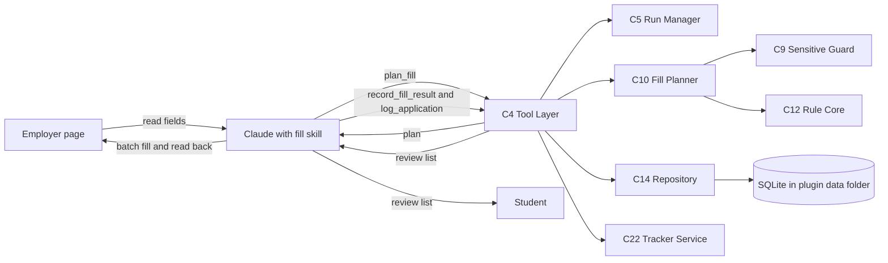
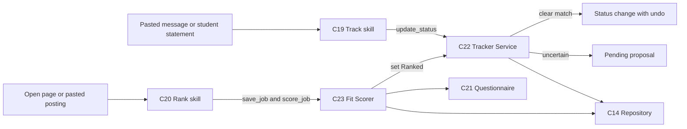

# Component Dependencies

**Version 2** (after the change request): adds C19-C23, removes C13 and C16.

## Dependency Matrix

Rows depend on columns ("X" = direct call or import).

| | C4 Tools | C5 Run | C6 Profile | C7 Docs | C8 Answers | C9 Sensitive | C10 Planner | C11 Rules | C12 Core | C14 Repo | C15 Log | C21 Quest. | C22 Tracker | C23 Scorer |
|---|---|---|---|---|---|---|---|---|---|---|---|---|---|---|
| Skills C1-C3, C19, C20 | X | | | | | | | | | | | | | |
| C4 Tools | | X | X | X | X | X | X | X | | X | X | X | X | X |
| C5 Run | | | | | | | | X | | X | X | | | |
| C6 Profile | | | | | | | | | | X | | | | |
| C7 Docs | | | | | | | | | | X | | | | |
| C8 Answers | | | | | | | | | | X | | | | |
| C9 Sensitive | | | | | | | | | | X | | | | |
| C10 Planner | | | | | | X | | | X | | | | | |
| C11 Rules | | | | | | | | | X | X | | | | |
| C21 Questionnaire | | | | | | | | | | X | | | | |
| C22 Tracker | | | | | | | | | | X | X | X | | |
| C23 Scorer | | | | | | | | | | X | | X | X | |
| C17 CI and Replay | | | | | | | | | X | | | | | |
| C18 Fixtures and Scorer | | | | | | | | | | | | | | |

**Rules**
- Skills reach the server only through C4 tools; C2 and C3 also use Claude in Chrome; C19 may use Claude's read-only Gmail connector (stretch goal).
- C14 is the only component that touches `node:sqlite`.
- Pure, separately testable logic: C10 planning, C12 rule core, C22 `canTransition` and `displayStatus`, C23 `checkHardConstraints` and `scoreFit`.
- C23 depends on C22 (to set Ranked), never the reverse; no cycles.

## Communication Patterns

| From | To | Pattern |
| --- | --- | --- |
| Claude (skills) | MCP server | Synchronous MCP tool calls over stdio; results `{ ok, code, message, data }` |
| Claude (skills) | Employer page | Claude in Chrome tools in the student's browser |
| Claude (C19) | Gmail (stretch goal) | Claude's read-only Gmail connector, only when the student asks |
| Server | Network | None: the server makes no network requests and opens no ports |
| GitHub Actions | C17 and fixtures | CI on every pull request |
| Server | Log file and stderr | JSON lines; stdout reserved for MCP |

## Data Flow - Fill a Page and Log It

Text alternative: Claude reads the page fields and calls `plan_fill`. The tool layer starts a run, loads the confirmed profile and personal rules from the repository, and asks the planner for one action per field, using the sensitive guard and rule core. Claude fills the page, reads values back, records the result, and logs the application in the tracker. The review list goes back to the student.

## Data Flow - Track and Rank

Text alternative: for tracking, the track skill turns a pasted message or statement into a proposal; the tracker service applies it with an undo entry when it is a clear match, otherwise stores it as pending. For ranking, the rank skill saves a posting and sends Claude's extracted facts and judgements to the fit scorer, which reads the questionnaire, computes the score, and creates or keeps the tracker entry at Ranked. Both store data through the repository.

## External Dependencies

| Dependency | Used by | Notes |
| --- | --- | --- |
| Claude Code (Claude Sonnet 5.5 in development) | Skills | Student's own plan; no API key in the product |
| Claude in Chrome | C2, C3, C20 (reading the open posting) | Student's visible browser |
| Claude Gmail connector (read only, stretch goal) | C19 | Only on request |
| `@modelcontextprotocol/sdk`, `zod` 3, `node:sqlite` | Server | Built-in SQLite, no native module |
| Vitest, fast-check, Playwright Test, GitHub Actions | Tests, C17 | Development only |
