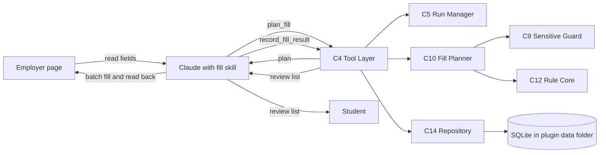
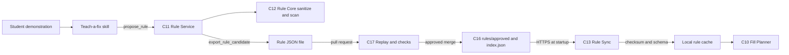

# Component Dependencies

## Dependency Matrix

Rows depend on columns ("X" = direct call or import).

| | C4 Tools | C5 Run | C6 Profile | C7 Docs | C8 Answers | C9 Sensitive | C10 Planner | C11 Rules | C12 Core | C13 Sync | C14 Repo | C15 Log |
|---|---|---|---|---|---|---|---|---|---|---|---|---|
| C1-C3 Skills | X | | | | | | | | | | | |
| C4 Tools | | X | X | X | X | X | X | X | | X | X | X |
| C5 Run | | | | | | | | X | | | X | X |
| C6 Profile | | | | | | | | | | | X | |
| C7 Docs | | | | | | | | | | | X | |
| C8 Answers | | | | | | | | | | | X | |
| C9 Sensitive | | | | | | | | | | | X | |
| C10 Planner | | | | | | X | | | X | | | |
| C11 Rules | | | | | | | | | X | | X | |
| C13 Sync | | | | | | | | | X | | X | X |
| C17 Replay | | | | | | | | | X | | | |
| C18 Scorer | | | | | | | | | | | | |

**Rules**
- Skills reach the server only through C4 tools (MCP stdio); skills also use Claude in Chrome tools directly.
- C14 is the only component that touches `node:sqlite`; C12 has no I/O and no database access, so it can be shared with C17.
- C10 is pure: it receives the profile and rules as arguments (C4 fetches them), which keeps it unit and property testable.
- No component depends on C4 or on a skill (no cycles).

## Communication Patterns

| From | To | Pattern |
| --- | --- | --- |
| Claude (skills) | MCP server | Synchronous MCP tool calls over stdio; JSON results `{ ok, code, message, data }` |
| Claude (skills) | Employer page | Claude in Chrome tools (read page, form input, click, upload) in the student's browser |
| C13 Sync | GitHub raw content | HTTPS GET with global `fetch`; read-only; no credentials |
| Student | GitHub | Pull requests with exported rule files (or via a teammate) |
| GitHub Actions | C17 / fixtures | CI job on pull requests touching `rules/` or `server/` |
| Server | Log file and stderr | JSON lines; stdout reserved for MCP |

## Data Flow - Fill a Page

Text alternative: Claude reads the page fields and calls `plan_fill`. The tool layer starts a run (C5), loads the confirmed profile and active rules from the repository (C14, SQLite), and asks the planner (C10) for one action per field; the planner consults the sensitive guard (C9) and rule core (C12). Claude fills the page in one batch, reads the values back, and calls `record_fill_result`, which returns the review list shown to the student.

## Data Flow - Shared Rules

Text alternative: a demonstration becomes a personal rule through the teach skill, the rule service and the rule core. An eligible rule is exported as JSON, submitted as a pull request, checked and replayed by CI, and merged into the shared library with its checksum in the index. Every install downloads the index at startup, verifies each rule, caches it, and the planner attaches it to matching controls.

## External Dependencies

| Dependency | Used by | Notes |
| --- | --- | --- |
| Claude Code (host, Claude Sonnet 5.5 in development) | Skills | Student's own plan; no API key in the product |
| Claude in Chrome | C2, C3 | Browser control in the student's visible browser |
| `@modelcontextprotocol/sdk` | C4 | stdio transport |
| `zod` 3 | C4, C12 | Schemas |
| `node:sqlite` | C14 | Built-in, no native module |
| GitHub (public repository) | C13, C16, C17 | Raw file hosting, pull requests, Actions |
| Vitest, fast-check, Playwright Test | Tests, C17 | Development only |
