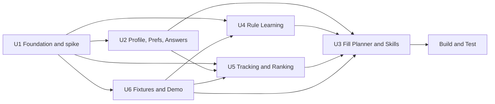

# Unit of Work Dependencies

**Version 2** (after the change request): six units; U5 Tracking and Ranking added; fixtures and demo are U6.

## Dependency Matrix

Rows depend on columns ("X" = needs that unit's output).

| | U1 Foundation | U2 Profile, Prefs, Answers | U3 Fill | U4 Rules | U5 Track and Rank | U6 Fixtures and Demo |
|---|---|---|---|---|---|---|
| U1 Foundation | - | | | | | |
| U2 Profile, Prefs, Answers | X | - | | | | |
| U3 Fill | X | X | - | X | X | X |
| U4 Rules | X | | | - | | X |
| U5 Track and Rank | X | X | | | - | X |
| U6 Fixtures and Demo | X | | | | | - |

No cycles: U1 is the root; U2 and U6 depend only on U1; U4 needs U6's fixtures for replay; U5 needs U2's questionnaire and profile and U6's messages and postings; U3 depends on all of them and integrates the fill flow.

## What Each Dependency Provides

| Consumer | Provider | What is needed | Interface |
| --- | --- | --- | --- |
| U2-U6 | U1 | Shared types and Zod schemas, error codes, tool registration, repository, logger, build, CI skeleton | `types.ts`, `core/schema.ts`, `db.ts`, `log.ts` |
| U3, U4 | U1 | Rule schema and fingerprints | `core/schema.ts`, `core/fingerprint.ts` |
| U3 | U2 | Confirmed profile, sensitive guard, documents, answers | C6, C9, C7, C8 |
| U3 | U4 | Active rules, resolved steps, read-back notification | C11, C12 |
| U3 | U5 | `log_application` after a fill (Ranked to In progress) | C22 |
| U3, U4 | U6 | Fixture forms and synthetic applicants | `fixtures/forms/`, `fixtures/applicants/` |
| U5 | U2 | Questionnaire (weights, hard constraints, No response cutoff); confirmed profile for skills judgement | C21, C6 |
| U5 | U6 | Labeled messages; postings and questionnaires | `fixtures/messages/`, `fixtures/postings/` |
| U6 (scorer) | U1 | Run-log, tracker and ranking result formats | `types.ts` |

## Build Order



Text alternative:
```
Step 1: U1 Foundation and Contracts (whole team, includes the Chrome plus MCP spike)
Step 2 (in parallel): U2 Profile, Preferences and Answers | U4 Rule Learning | U5 Tracking and Ranking | U6 Fixtures, Tests and Demo
        (U4 replay starts once U6's first fixture form exists; U5 builds against U1's questionnaire contract
         and integrates U2's questionnaire service as soon as it merges)
Step 3: U3 Fill Planner and Skills (integrates U2, U4, U5, U6)
Step 4: Build and Test across all units
```

## Integration Approach (Q2)
- Contract first: U1 merges shared types and schemas before other units integrate; contract changes need review by every affected unit owner.
- Units integrate in-process through the C4 tool layer; there is no network boundary between units.
- Until a provider unit merges, consumers use small test doubles that satisfy the shared types (for example, a fixed `Questionnaire` in U5 scorer tests).

## Shared Resources
| Resource | Owner | Users |
| --- | --- | --- |
| SQLite schema and migrations | U1 | U2, U3, U4, U5 |
| `server/src/index.ts` tool registration | U1 | each unit adds its handlers |
| CI workflow | U1 (skeleton) | U4 adds the replay job |
| Fixtures, messages, postings | U6 | U3, U4, U5 |

## Risks
| Risk | Affected units | Mitigation |
| --- | --- | --- |
| Chrome plus MCP cannot run in one session | U3, U4 | Spike in U1 first; fill-sheet fallback (S3); U5 does not need the browser |
| Scope of three features | U3, U5 | Shared library removed; Gmail is a stretch goal; U5 starts in parallel in step 2 |
| Contract changes late in Construction | All | Contract changes need review by all affected owners |
| Replay flakiness in CI | U4, U6 | Static fixtures served locally; deterministic `wait_for` steps |
| Ranking quality disputes | U5, U6 | Team agrees the top-3 orderings in U6 before tuning weights |
