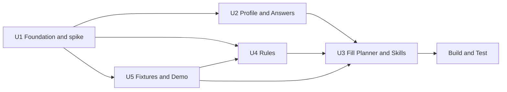

# Unit of Work Dependencies

## Dependency Matrix

Rows depend on columns ("X" = needs that unit's output).

| | U1 Foundation | U2 Profile and Answers | U3 Fill | U4 Rules | U5 Fixtures and Demo |
|---|---|---|---|---|---|
| U1 Foundation | - | | | | |
| U2 Profile and Answers | X | - | | | |
| U3 Fill | X | X | - | X | X |
| U4 Rules | X | | | - | X |
| U5 Fixtures and Demo | X | | | | - |

No cycles: U1 is the root; U2, U4 and U5 depend on U1 (U4 also needs U5's fixtures for replay); U3 depends on all of them and integrates the flow.

## What Each Dependency Provides

| Consumer | Provider | What is needed | Interface |
| --- | --- | --- | --- |
| U2, U3, U4, U5 | U1 | Shared types and Zod schemas, error codes, tool registration pattern, repository, logger, build | `types.ts`, `core/schema.ts`, `db.ts`, `log.ts` |
| U3, U4 | U1 | Rule schema and control/page fingerprints | `core/schema.ts`, `core/fingerprint.ts` |
| U3 | U2 | Confirmed profile, sensitive guard, documents, answers | C6 `confirmedRecords`/`flatten`, C9 `classify`/`answerFor`, C7 `resolve`, C8 `find` |
| U3 | U4 | Active rules with resolved steps; read-back notification | C11 `activeRules`, `noteReadBack`; C12 `resolveSteps` |
| U3 | U5 | Fixture forms to test the fill flow | `fixtures/forms/` |
| U4 | U5 | Fixture forms and synthetic applicants for replay | `fixtures/forms/`, `fixtures/applicants/` |
| U5 (scorer) | U1 | Run-log format | `types.ts` run-log types |

## Build Order (Q4)



Text alternative:
```
Step 1: U1 Foundation and Contracts (includes the Chrome plus MCP spike)
Step 2 (in parallel): U2 Profile and Answers | U5 Fixtures and Demo | U4 Rules
        (U4 replay work starts once U5's first fixture form exists)
Step 3: U3 Fill Planner and Skills (integrates U2, U4, U5)
Step 4: Build and Test across all units
```

## Integration Approach (Q2)
- Contract first: U1 merges the shared types and schemas before other units integrate; changes to contracts go through a pull request reviewed by the U1 owner and every affected unit owner.
- Units integrate in-process through the C4 tool layer; there is no network boundary between units.
- Until a provider unit is merged, consumers use small test doubles that satisfy the shared types (for example, a fixed `Profile` in U3 planner tests).

## Shared Resources
| Resource | Owner | Users |
| --- | --- | --- |
| SQLite schema and migrations | U1 | U2, U3, U4 |
| `server/src/index.ts` tool registration | U1 | each unit adds its handlers |
| CI workflow | U1 (skeleton) | U4 adds the replay job |
| Fixture forms and applicants | U5 | U3, U4 |

## Risks
| Risk | Affected units | Mitigation |
| --- | --- | --- |
| Chrome plus MCP cannot run in one session | U3 | Spike in U1 first; fill-sheet fallback mode (S3) |
| Contract changes late in Construction | All | Contract changes need review by all affected owners |
| Replay flakiness in CI | U4, U5 | Static fixtures served locally; deterministic waits (`wait_for`) |
