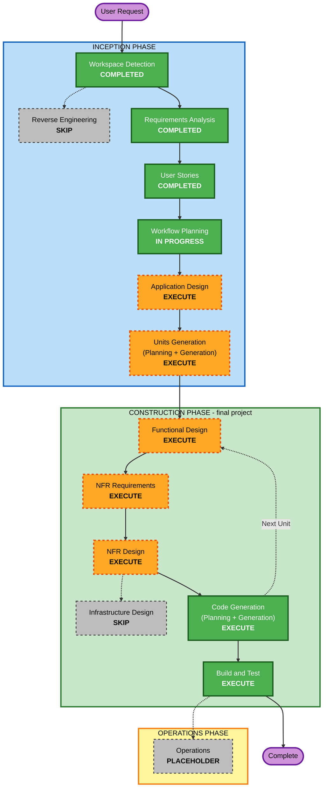

# Execution Plan

## Context Loaded
- `aidlc-docs/inception/requirements/requirements.md` and `requirement-verification-questions.md` (23 answers)
- `aidlc-docs/inception/user-stories/stories.md` version 2 (11 active epics, 39 stories) and `personas.md` (4 personas)
- `aidlc-docs/inception/requirements/requirement-change-questions.md` (change request: add tracking and ranking, remove the shared fix library)

**Version 2**: revised after the change request. Stage decisions are unchanged; scope, impact, risk, rationale and deliverables now cover apply, track and rank.
- `vision.md`, `tech-env.md`
- Project type: Greenfield (no reverse engineering artifacts)

## Detailed Analysis Summary

### Change Impact Assessment
- **User-facing changes**: Yes. Three conversational workflows inside Claude Code (set up profile, fill application, teach a fix), plus review lists, approvals and data deletion.
- **Structural changes**: Yes. A new Claude Code plugin with five skills (set up profile, fill application, teach a fix, track applications, rank a job), a local MCP server, a CI workflow, and fixture forms, messages and postings.
- **Data model changes**: Yes. New SQLite schema for profile records with confirmation status, documents, scoped answers, sensitive answers, questionnaire, personal rules, run history, jobs, rankings, applications, status history and pending updates; a JSON rule schema for personal rules.
- **API changes**: Yes. New MCP tool contracts (`plan_fill`, `record_fill_result`, `propose_rule`, `log_application`, `update_status`, `score_job` and others) defined with Zod.
- **NFR impact**: Yes. Security Baseline enabled (personal data, prompt injection, supply chain, checksums); performance target of under 5 minutes per two-page form; 70% coverage; partial property-based testing.

### Risk Assessment
- **Risk Level**: Medium-High. The riskiest dependency is running Claude in Chrome and the MCP server in one session; a fallback (fill sheet in chat, US-9.4) is already specified. Scope is the second risk: three features in three weeks, mitigated by removing the shared fix library and keeping Gmail as a stretch goal. Tracking and ranking need no browser control, so they still work if the browser path fails.
- **Rollback Complexity**: Easy. Local plugin; a failing rule is disabled automatically, and every automatic status change can be undone.
- **Testing Complexity**: Complex. Unit tests, fast-check properties, Playwright replay on three fixture forms for three synthetic applicants, 20 labeled messages, 10 postings with two questionnaires, and a recorded manual scenario run.

## Workflow Visualization



### Text Alternative
```
Phase 1: INCEPTION (mid-semester milestone, due 2026-11-24)
- Workspace Detection ........ COMPLETED
- Reverse Engineering ........ SKIPPED (greenfield)
- Requirements Analysis ...... COMPLETED
- User Stories ............... COMPLETED
- Workflow Planning .......... IN PROGRESS
- Application Design ......... EXECUTE
- Units Generation ........... EXECUTE  -> STOP here for the milestone

Phase 2: CONSTRUCTION (final project, due 2026-12-16), per unit:
- Functional Design .......... EXECUTE
- NFR Requirements ........... EXECUTE
- NFR Design ................. EXECUTE
- Infrastructure Design ...... SKIP
- Code Generation ............ EXECUTE
- Build and Test (all units) . EXECUTE

Phase 3: OPERATIONS .......... PLACEHOLDER (not required for the course)
```

## Phases to Execute

### INCEPTION PHASE
- [x] Workspace Detection (COMPLETED)
- [x] Reverse Engineering (SKIPPED - greenfield, no existing code)
- [x] Requirements Analysis (COMPLETED)
- [x] User Stories (COMPLETED)
- [x] Workflow Planning (IN PROGRESS)
- [ ] Application Design - EXECUTE
  - **Rationale**: Every component is new. The skills, MCP tools, store, planner, rule engine, sanitizer, tracker with status rules, and fit scorer need defined responsibilities, method signatures and dependencies, and the Chrome-unavailable fallback (US-9.4) must be designed as an alternate path.
- [ ] Units Generation - EXECUTE
  - **Rationale**: The system spans several modules and five work streams (profile, preferences and answer store; fill planner and skills; rule learning; application tracking and job ranking; fixtures and tests). Each unit needs one owner and one reviewer in Construction.

### CONSTRUCTION PHASE (final project)
- [ ] Functional Design - EXECUTE (per unit)
  - **Rationale**: New data models (records with confirmation status, scoped answers, rule JSON schema) and business rules (exact-match sensitive answers, sanitization, read-back disabling). PBT-01 property identification also happens here.
- [ ] NFR Requirements - EXECUTE (per unit)
  - **Rationale**: Security Baseline is enabled, there is a performance target (NFR-1.1) and a coverage target (NFR-5.2); the PBT framework (fast-check) must be pinned per unit.
- [ ] NFR Design - EXECUTE (per unit)
  - **Rationale**: Security patterns (Zod validation, parameterized SQL, fail-closed handling, checksum verification, prompt-injection boundaries) must be placed into each unit's design.
- [ ] Infrastructure Design - SKIP
  - **Rationale**: The product runs locally with no cloud resources. The only hosted pieces are Claude itself, the optional read-only Gmail connector (provided by Claude, nothing to deploy), and a GitHub Actions workflow already specified in `tech-env.md`; the CI workflow is built in Code Generation.
- [ ] Code Generation - EXECUTE (ALWAYS)
  - **Rationale**: Implementation planning and code generation needed for each unit.
- [ ] Build and Test - EXECUTE (ALWAYS)
  - **Rationale**: Build, unit, property, replay and scenario tests verify SC1-SC7.

### OPERATIONS PHASE
- [ ] Operations - PLACEHOLDER
  - **Rationale**: Not required for this course project.

## Milestone Boundary
For the mid-semester milestone the workflow stops after Units Generation is approved. Construction starts in the final project.

## Estimated Timeline
- **Total stages to execute**: 11 (4 Inception stages completed or in progress, 2 remaining Inception stages, 5 Construction stages per unit)
- **Inception**: completes on 2026-11-24
- **Construction**: 2026-11-25 to 2026-12-14, one unit at a time per owner with a reviewer; the Chrome plus MCP spike runs first (Q20)
- **Demo and submission**: 2026-12-16

## Success Criteria
- **Primary Goal**: A working Claude Code plugin that helps students apply, track and rank, meeting demo success criteria SC1-SC7 on synthetic data.
- **Key Deliverables**: Plugin with five skills and a bundled MCP server; tracker and fit scoring; fixture forms, synthetic applicants and answer key; labeled messages and postings; CI; test suite; demo run report.
- **Quality Gates**:
  - Every story's acceptance criteria pass
  - Unit coverage on `server/src` at least 70%; PBT-02, 03, 07, 08, 09 satisfied
  - `claude plugin validate --strict` passes
  - Security Baseline compliance summary has no blocking findings at every stage
  - Taught rules pass schema, personal-data scan and replay; status rules and scoring rules have unit and property tests
